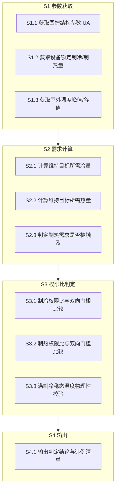
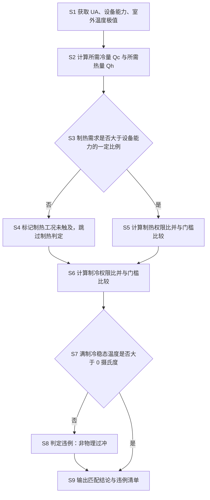

# 交底书草稿 A · 一种基于制冷制热权限比的空调设备与围护结构匹配判定方法及系统

> **状态**：草稿（**未经查新**）｜ **类型**：发明 ｜ **日期**：2026-10-15
> **⚠️ 使用前必读**：
> 1. 第一章现有技术**故意留空**——技能规范禁止"假 D1"（`patent_points_analyzer.md:31`），必须由真实检索填入，**不得编造对比文献**。
> 2. `【】` 处需你确认。
> 3. 第五章已按**删除测试**预分 5.1/5.2，便于直接转权利要求书。
> 4. **本文档不构成法律意见**。

---

```markdown
# 技术交底书

**案件名称**：一种基于制冷制热权限比的空调设备与围护结构匹配判定方法及系统

**技术联系人**：
- 姓名：【待填写】
- 电话：【待填写】
- 邮箱：【待填写】

**专利类型**：发明

---

## 注意事项

（1）交底书应使代理人能看懂，尤其是背景技术和详细技术方案，一定要写得全面、清楚、完整；
（2）技术的公开程度，应以本领域普通技术人员不需付出创造性劳动即可进行实施为准。
（3）在与代理人沟通时，对于代理人咨询的技术问题，应给予回答并认真讲解，并且按要求及时正确地补充相应技术材料。

---

## 一、技术背景与现有技术

### 1.1 现有技术

【⚠️ 本节须在完成检索后填写，不得编造。建议检索方向：

| 方向 | 建议检索词 | 预期可补充的对比点 |
|------|-----------|-------------------|
| 方向一 | 空调 选型 制冷量 匹配 | 传统按面积/经验估算冷负荷 |
| 方向二 | 房间 热负荷 计算 围护结构 | 稳态热平衡计算 |
| 方向三 | HVAC 可控性 判定 裕量 | 设备容量裕量的经验区间 |

检索渠道：国家知识产权局中国专利公布公告站（epub.cnipa.gov.cn）。
每条现有技术须含：公开号、申请人、技术方案、应用场景、局限性、**公开源 URL（必填）**。
若无足够近邻，如实写"检索范围内近邻较少"，**禁止编造条目凑数**。】

### 1.2 现有技术存在的缺点

【待检索后落到 D1】典型缺点预期为：

1. 空调选型主要依赖单位面积冷负荷指标或经验估算，**未对所选设备与具体房间围护结构是否匹配做可计算的判定**；
2. 即使做了热负荷计算，也**只验算单侧（通常只验算制冷是否足够）**，不验算"设备过大"导致的过冲风险；
3. 缺乏对**室外温度接近室内设定值**这一工况的处理——此时制热（或制冷）需求趋近于零，直接计算需求-能力比值会得到无意义的巨大值或除零错误。

---

## 二、本发明所要解决的技术问题

本发明要解决的技术问题是：如何提供一种**可计算、可断言、能同时识别"设备能力不足"与"设备能力过剩"、并能在需求趋近于零的工况下避免无效判定**的空调设备与围护结构匹配判定方法。

---

## 三、本发明技术方案的详细阐述

### 3.1 背景

在建筑空调系统的设计与调试阶段，需要确认所配置的空调设备容量与该房间的围护结构（墙体传热系数、窗墙比、房间容积等）是否匹配。

若设备制冷能力**不足**，则满负荷运行也无法将室温降至目标值，控制目标不可达；若设备能力**过剩**，则满功率运行时稳态温度会越过物理下界（例如降到 0 °C 以下），造成"一开就过冲"的非物理行为，同样使控制失效。

本方法以**权限比**（设备可用能力与维持目标所需负荷之比）作为判据，对制冷与制热两个方向分别判定。

### 3.2 系统框图



### 3.3 模块功能说明

- **S1 参数获取模块**：汇集围护结构综合传热系数 UA、设备额定制冷量与制热量、室外温度峰值与谷值、太阳得热峰值与室内热源强度。
- **S2 需求计算模块**：按稳态热平衡计算维持目标温度所需冷量与热量；并判定制热需求在当前工况下是否被触及。
- **S3 判定模块**：分别计算制冷与制热权限比，与上下限门槛比较；并对满制冷稳态温度做物理性校验。
- **S4 输出模块**：输出是否匹配的结论及具体违例原因。

### 3.4 系统流程说明



### 3.4.1 符号与公式

设围护结构综合传热系数为 UA（单位 W/K），目标温度 T_set，室外温度峰值 T_out,max，太阳得热峰值 Q_solar，室内热源强度 Q_int，设备额定制冷量与制热量分别为 Q_ac,c 与 Q_ac,h，其性能系数分别为 COP_c 与 COP_h。

**(1) 所需冷量**

    Q_req,c = UA · (T_out,max − T_set) + Q_solar + Q_int

**(2) 可用冷量**

    Q_avail,c = Q_ac,c · COP_c

**(3) 制冷权限比**

    R_c = Q_avail,c / Q_req,c

**(4) 所需热量**

    Q_req,h = UA · (T_set − T_out,min) − Q_int

**(5) 制热权限比**

    R_h = Q_avail,h / Q_req,h

**(6) 满制冷稳态温度**

    T_inf,c = T_out,max + (Q_solar + Q_int − Q_avail,c) / UA

### 3.5 关键技术参数

| 符号 | 含义 | 取值范围 | 说明 |
|------|------|---------|------|
| UA | 围护结构综合传热系数 | 50–150 W/K | 单房间量级 |
| R_c | 制冷权限比 | 判定区间 [1, 8] | < 1 压不住；> 8 过大 |
| R_h | 制热权限比 | 判定区间 [1, 8] | 仅在需求被触及时判定 |
| T_set | 目标温度 | 24 °C | 工作时段 |
| 触及阈值 | 制热需求占设备能力比例 | 5% | 低于此值视为本工况未触及 |
| T_inf,c | 满制冷稳态温度 | 须 > 0 °C | 物理性校验 |

---

## 四、与现有技术相比，本发明具有哪些优点

1. **双向判定**：同时识别"设备能力不足"（压不住）与"设备能力过剩"（一开就过冲）两种反向失配，而非常规做法只验算能力是否足够；
2. **判据为无量纲比值**：以权限比而非绝对温度作为判据，直接对应"设备相对房间够不够大"这一物理问题，便于跨房间、跨设备规格统一比较；
3. **零需求工况的稳健处理**：当室外温度接近设定值、制热（制冷）需求趋近于零时，通过"需求占设备能力比例"的触发条件判定该方向是否被触及，避免产生无意义的巨大比值或除零错误；
4. **附加物理性校验**：通过满制冷稳态温度是否大于 0 °C 的校验，捕获比值判定可能遗漏的非物理过冲情形；
5. **可自动化执行**：判据全部为可断言的算术比较，可置于设计校验流程或持续集成中自动执行，在设备选型阶段即发现失配。

---

## 五、本发明的技术关键点和欲保护点是什么

### 5.1 必要技术特征

（按删除测试：删除任一特征后，方案无法解决所述技术问题）

- **F1 双向权限比判定**：分别计算制冷权限比 R_c = 设备可用冷量 / 维持目标所需冷量、制热权限比 R_h = 设备可用热量 / 维持目标所需热量，并分别与预设的上下限门槛比较，以同时识别设备能力不足与设备能力过剩两种失配。
- **F2 所需负荷的稳态热平衡计算**：所需冷量按围护结构传热项（UA 乘以室外峰值温度与目标温度之差）、太阳得热项与室内热源项之和计算。
- **F3 零需求工况的触发条件判定**：对制热（或制冷）方向，先判定其需求是否大于设备可用能力的一个预设比例，仅在大于时才执行该方向的权限比判定，否则标记该工况下该方向未被触及。

### 5.2 优选特征

- **F4 满制冷稳态温度物理性校验**：按 T_inf,c = T_out,max + (Q_solar + Q_int − Q_avail,c) / UA 计算满制冷稳态温度，若不大于 0 °C 则判定为非物理过冲。
- **F5 门槛取值**：权限比的上下限分别取 1 与 8。
- **F6 触发比例取值**：所述预设比例取 5%。
- **F7 判据的自动化执行**：将 F1–F3 的判定封装为在设备选型阶段或持续集成流程中自动执行的校验步骤，不满足时中止并输出违例原因。

---

## 六、其它

### 6.1 实施例

某单房间建筑面积约 50 m²，围护结构综合传热系数 UA = 150 W/K，空调额定制冷量 3500 W、性能系数 3.0，室外温度峰值 35 °C、谷值 23 °C，太阳得热峰值 2800 W，白天室内热源 550 W、夜间 50 W，目标温度 24 °C。

所需冷量 Q_req,c = 150 × (35 − 24) + 2800 + 550 = 1650 + 3350 = 5000 W；
可用冷量 Q_avail,c = 3500 × 3.0 = 10500 W；
制冷权限比 R_c = 10500 / 5000 = 2.1，落在 [1, 8] 内，制冷方向匹配。

满制冷稳态温度 T_inf,c = 35 + (2800 + 550 − 10500) / 150 = 35 − 47.7 = −12.7 °C。

⚠️ 该实施例中 T_inf,c 为负值，触发 F4 的物理性校验违例——说明**即使权限比落在区间内，仍可能存在非物理过冲**，这正是 F4 作为附加校验的价值所在。

【注：上例取自本项目实测参数。实际申请时建议补充一个各项均通过的实施例。】

### 6.2 技术效果

- 在设备选型阶段即可发现"压不住"与"过大过冲"两类失配；
- 避免因参数失配导致的无效仿真与控制目标不可达；
- 判定过程可自动化，减少对经验的依赖。

### 6.3 参数示例

【建议补充：一组 UA = 150 W/K、制冷权限比落在中间区间且满制冷稳态温度大于 0 °C 的参数组合，作为"通过"示例。】
```

---

## 交底书之外 · 申请前必须处理的 3 件事

| # | 事项 | 说明 |
|---|---|---|
| 1 | **确认公开时间** | 本方案的代码（`check_controllability`）**目前未提交、未公开** ⇒ 新颖性风险最低。**建议保持私有直到申请日**。 |
| 2 | **补"通过"实施例** | 上文实施例触发了过冲违例，需再补一组全部通过的参数作为对照 |
| 3 | **完成查新** | 第一章 1.1 必须由真实检索填入 |

---

*本文档未经查新，创造性未证。不构成法律意见。*
