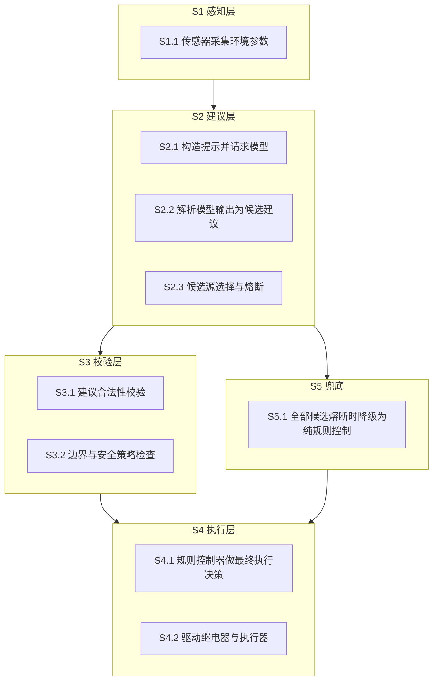
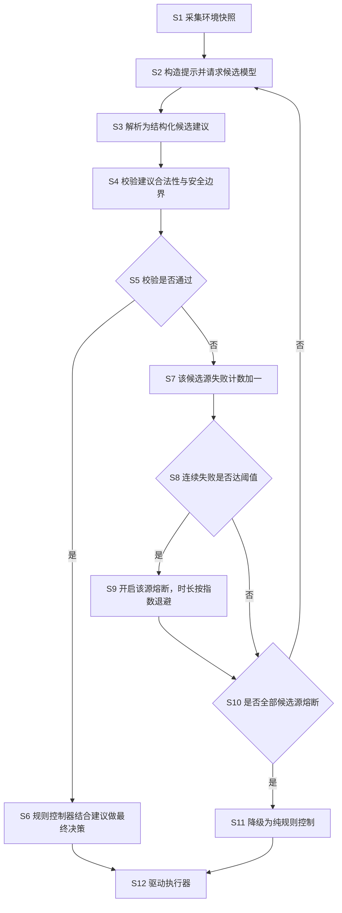

# 交底书草稿 C · 一种大模型建议与物理执行解耦的边缘环境控制方法及系统

> **状态**：草稿（**未经查新**）｜ **类型**：发明 ｜ **日期**：2026-10-15
> **⚠️ 使用前必读**：第一章现有技术**故意留空**（禁止假 D1）；`【】` 处需你确认；**不构成法律意见**。

---

```markdown
# 技术交底书

**案件名称**：一种大模型建议与物理执行解耦的边缘环境控制方法及系统

**技术联系人**：【待填写】

**专利类型**：发明

---

## 注意事项

（1）交底书应使代理人能看懂，尤其是背景技术和详细技术方案，一定要写得全面、清楚、完整；
（2）技术的公开程度，应以本领域普通技术人员不需付出创造性劳动即可进行实施为准。
（3）在与代理人沟通时，对于代理人咨询的技术问题，应给予回答并认真讲解，并且按要求及时正确地补充相应技术材料。

---

## 一、技术背景与现有技术

### 1.1 现有技术

【⚠️ 待真实检索填入，不得编造。建议检索方向：

| 方向 | 建议检索词 |
|------|-----------|
| 方向一 | 大语言模型 控制 执行器 安全 |
| 方向二 | 智能家居 云端 失效 本地 降级 |
| 方向三 | 熔断 降级 模型 服务 可用性 |

每条须含公开号、技术方案、局限性、**公开源 URL**。】

### 1.2 现有技术存在的缺点

【待检索后落到 D1】预期缺点：

1. 将大模型输出**直接**作为设备控制指令，模型幻觉、超时或返回非法指令时可能导致**误动作甚至设备损坏**；
2. 云端不可达时，部分方案**直接停止控制**，导致闭环中断、室温失控；
3. 通用熔断机制**未针对"建议"与"执行"的语义分离**做设计，熔断恢复后仍可能放行未经校验的模型输出。

---

## 二、本发明所要解决的技术问题

如何使大模型参与物理环境控制时，**既不丧失其决策建议的价值，又保证任何模型异常（幻觉、超时、非法输出、服务不可达）都不会导致物理执行器误动作或控制闭环中断**。

---

## 三、本发明技术方案的详细阐述

### 3.1 背景

边缘环境控制系统通过传感器采集温度、湿度、光照等参数，并驱动继电器、窗帘电机等执行器调节室内环境。系统可接入大语言模型以生成控制建议（例如"建议开启空调至 24 °C"）。

由于模型输出具有不确定性，且云端服务可能不可达，必须建立**建议层与执行层之间的安全边界**。

### 3.2 系统框图



### 3.3 模块功能说明

- **S2 建议层**：将当前环境快照与候选动作池构造成提示，请求模型返回建议；将自由文本输出解析为结构化候选建议；对多个候选模型源维护独立的可用性状态。
- **S3 校验层**：对候选建议做合法性校验（字段完整性、取值域、动作类型白名单）与安全边界检查（是否违反最小运行时间等硬约束）。
- **S4 执行层**：规则控制器综合当前环境、控制策略与校验后的建议，做出**最终执行决策**；建议本身不直接产生执行动作。
- **S5 兜底层**：当全部候选源处于熔断状态时，系统自动切换为纯规则控制，闭环不中断。

### 3.4 系统流程说明



### 3.4.1 符号与公式

**(1) 熔断开启时长（指数退避）**

    T_open = min(T_base · 2^min(n, N_cap), T_max)

其中 T_base 为基准时长，n 为该源累计熔断次数，N_cap 为退避次数上限，T_max 为最大开启时长。

**(2) 候选源评分指数滑动平均**

    s_k = α · score_k + (1 − α) · s_{k−1}

其中 α 为平滑系数。

### 3.5 关键技术参数

| 符号 | 含义 | 取值范围 | 说明 |
|------|------|---------|------|
| 熔断阈值 | 连续失败次数 | 2 | 达阈值开启熔断 |
| T_base | 熔断基准时长 | 20 s | — |
| T_max | 熔断最大时长 | 600 s | — |
| N_cap | 退避次数上限 | 4 | 限制为 16 倍基准 |
| α | 评分平滑系数 | 0.2 | EMA |

---

## 四、与现有技术相比，本发明具有哪些优点

1. **语义隔离**：模型输出仅作为建议，由规则控制器做出最终执行决策，从架构上杜绝"模型直接驱动执行器"；
2. **多源独立熔断**：对每个候选模型源独立计数与熔断，单源异常不影响其他源，且熔断时长按指数退避，避免频繁重试打爆下游；
3. **闭环不中断**：全部候选源熔断时自动降级为纯规则控制，环境控制闭环持续运行；
4. **输出校验前置**：在建议进入决策前完成合法性与安全边界校验，非法输出不产生执行动作；
5. **可观测**：各源的成功/失败计数、熔断次数与评分指数滑动平均值可输出，便于运维定位。

---

## 五、本发明的技术关键点和欲保护点是什么

### 5.1 必要技术特征

- **F1 建议与执行的语义分离**：将模型输出限定为候选建议，由独立的规则控制器基于当前环境参数与控制策略做出最终执行决策，模型输出不直接驱动执行器。
- **F2 建议的结构化校验**：在候选建议进入决策前，对其进行字段完整性与取值域的合法性校验，以及针对执行器硬约束的安全边界检查，校验不通过的建议被丢弃且不产生执行动作。
- **F3 多候选源独立熔断与降级**：对每个候选模型源维护独立的连续失败计数，达到阈值时开启该源熔断并按指数退避延长开启时长；当全部候选源均处于熔断状态时，自动降级为纯规则控制以维持控制闭环。

### 5.2 优选特征

- **F4 熔断时长的指数退避计算**：按 T_open = min(T_base · 2^min(n, N_cap), T_max) 计算。
- **F5 候选源评分指数滑动平均**：按 s_k = α·score_k + (1−α)·s_{k−1} 计算，α 取 0.2。
- **F6 参数取值**：连续失败阈值取 2，T_base 取 20 s，T_max 取 600 s，N_cap 取 4。
- **F7 环境参数类型**：所述环境参数包括温度、湿度、光照度、等效二氧化碳浓度中的至少一种；所述执行器包括空调继电器、照明继电器、新风继电器、窗帘电机中的至少一种。

---

## 六、其它

### 6.1 实施例

系统运行于边缘计算设备，周期采集温度与光照数据。每周期将环境快照与候选动作池构造为提示，请求主候选模型；模型返回文本形式建议后，解析为结构化建议对象。

校验层检查动作类型是否在白名单内、目标温度是否落在允许区间、是否违反压缩机最小运行时间约束。通过校验的建议交由规则控制器，控制器结合当前温度偏差与死区判断后决定是否实际切换继电器状态。

当主候选模型连续两次失败时，其熔断开启 20 秒；若继续失败，开启时长按 20 → 40 → 80 → 160 → 320 → 600 秒退避递增。若备用候选亦熔断，系统切换为纯规则控制，继电器切换完全由规则控制器驱动，闭环不中断。

### 6.2 技术效果

- 模型异常时物理执行器不发生误动作；
- 云端不可达时控制闭环持续运行；
- 熔断与降级过程可观测、可计数。

### 6.3 参数示例

【建议补充实测的失败计数与熔断次数统计作为效果佐证。】
```

---

## ⚠️ 本方案的特有风险

| 风险 | 说明 | 对策 |
|---|---|---|
| **熔断器是成熟技术** | 微服务领域的 circuit breaker 为公知技术，单独主张"用熔断器"**创造性不足** | 权利要求必须落在 **F1（语义分离）+ F2（物理安全校验）+ F3（降级维持闭环）的组合**上，而非熔断器本身 |
| **抽象性风险** | 若写成"一种模型调用管理方法"可能被认定为智力活动规则 | 必须绑定**物理执行器**与**环境物理量**，写明"不产生执行动作"这一物理后果 |
| **公开时间** | `circuit_breaker.py` 等**已在公开仓库中**（见风险评估） | ⚠️ 新颖性可能已受影响，**必须查新并咨询代理机构** |

---

*本文档未经查新，创造性未证。不构成法律意见。*
