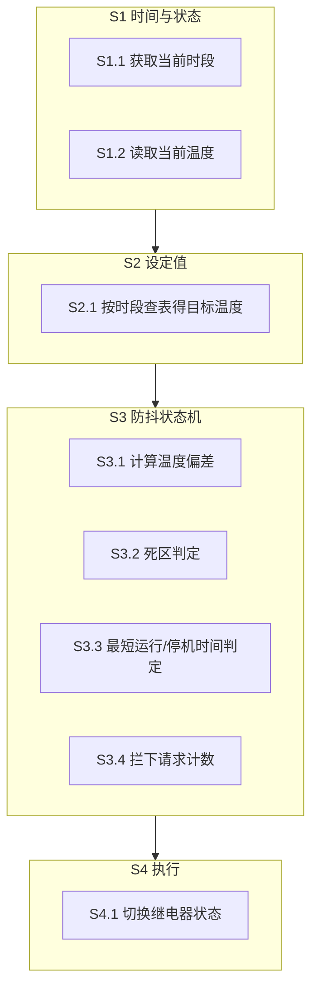
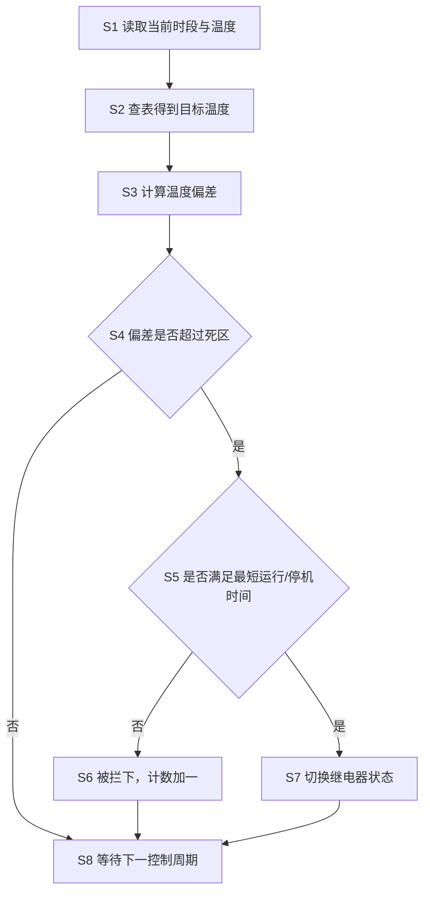

# 交底书草稿 D · 一种分时段设定值与防抖约束结合的空调节能控制方法

> **状态**：草稿（**未经查新**）｜ **类型**：发明 ｜ **日期**：2026-10-15
> **⚠️ 使用前必读**：第一章现有技术**故意留空**（禁止假 D1）；`【】` 处需你确认；**不构成法律意见**。
> **⚠️ 本方案创造性风险最高**（防抖/死区分时段控制在空调领域属常规技术），见文末风险表。

---

```markdown
# 技术交底书

**案件名称**：一种分时段设定值与防抖约束结合的空调节能控制方法

**技术联系人**：【待填写】

**专利类型**：发明

---

## 注意事项

（1）交底书应使代理人能看懂，尤其是背景技术和详细技术方案，一定要写得全面、清楚、完整；
（2）技术的公开程度，应以本领域普通技术人员不需付出创造性劳动即可进行实施为准。
（3）在与代理人沟通时，对于代理人咨询的技术问题，应给予回答并认真讲解，并且按要求及时正确地补充相应技术材料。

---

## 一、技术背景与现有技术

### 1.1 现有技术

【⚠️ 待真实检索填入，不得编造。建议检索方向：

| 方向 | 建议检索词 |
|------|-----------|
| 方向一 | 空调 分时段 设定温度 节能 控制 |
| 方向二 | 压缩机 最小运行时间 防抖 保护 |
| 方向三 | 死区 控制 空调 启停 次数 |

每条须含公开号、技术方案、局限性、**公开源 URL**。】

### 1.2 现有技术存在的缺点

【待检索后落到 D1】预期缺点：

1. 定值控制或简单定时控制在无人时段仍维持较低设定值，**无谓能耗高**；
2. 仅采用死区控制时，温度在死区边界附近波动仍会导致执行器频繁启停，**损伤压缩机与继电器**；
3. 防抖效果**缺乏可验证的量化指标**，难以证明"到底减少了多少次无效切换"。

---

## 二、本发明所要解决的技术问题

如何在保证室内温度满足使用需求的前提下，**降低空调系统在非使用时段的无谓能耗，并将执行器启停次数抑制到可验证的水平**。

---

## 三、本发明技术方案的详细阐述

### 3.1 背景

空调系统的能耗主要来自压缩机运行。在办公楼等场景中，使用时段集中在工作时段，而夜间与无人时段仍维持与工作时段相同的温度设定值会造成显著浪费。

同时，压缩机与继电器存在**最小运行时间**与**最小停机时间**的物理约束：过于频繁的启停会缩短设备寿命并增加能耗。因此控制系统需要在满足温度需求的同时主动抑制无效切换。

### 3.2 系统框图



### 3.3 模块功能说明

- **S2 设定值模块**：按当前时段查找对应目标温度（预热段、工作段、夜间段）。
- **S3 防抖状态机**：封装二值执行器的启停状态，强制最小运行时间与最小停机时间；对**被拦下的切换请求计数**，作为可验证的可靠性指标。
- **S4 执行模块**：仅当状态机允许时切换继电器。

### 3.4 系统流程说明



### 3.4.1 符号与公式

设当前时刻为 t，上次切换时刻为 t_last，目标温度为 T_set(t)，当前温度为 T，死区为 Δ，最短运行时间为 τ_run，最短停机时间为 τ_stop。

**(1) 分时段设定值**

    T_set(t) = { T_pre,  预热段
               { T_work, 工作段
               { T_night, 夜间段

**(2) 死区判定**

    需要动作  ⟺  |T − T_set(t)| > Δ

**(3) 防抖约束**

    允许启动  ⟺  (t − t_last) ≥ τ_stop
    允许停止  ⟺  (t − t_last) ≥ τ_run

### 3.5 关键技术参数

| 符号 | 含义 | 取值 | 说明 |
|------|------|------|------|
| T_pre | 预热段设定值 | 22 °C | 提前降温 |
| T_work | 工作段设定值 | 24 °C | — |
| T_night | 夜间段设定值 | 28 °C | 放宽以节能 |
| Δ | 控制死区 | 【待确认】 | — |
| τ_run | 最短运行时间 | 900 s | 15 分钟 |
| τ_stop | 最短停机时间 | 600 s | 10 分钟 |
| 照明阈值 | 光照触发阈值 | 【待确认】 | 照度低于阈值才开灯 |

---

## 四、与现有技术相比，本发明具有哪些优点

1. **分时段降温**：在预热段、工作段、夜间段采用递进的设定值，夜间放宽设定值以降低无谓能耗；
2. **双约束防抖**：同时施加最短运行时间与最短停机时间约束，抑制执行器在死区边界附近的抖动；
3. **可验证的防抖指标**：对被拦下的切换请求进行计数，使"在给定运行周期内拦下了多少次无效切换"成为可量化、可验证的可靠性论据，而不仅依赖主观判断；
4. **光照联动照明**：照明按实测照度阈值触发而非固定时段，进一步降低照明能耗。

---

## 五、本发明的技术关键点和欲保护点是什么

### 5.1 必要技术特征

- **F1 分时段递进设定值**：将运行周期划分为至少三个时段（预热段、工作段、夜间段），各时段采用递进的温度设定值，其中夜间段设定值高于工作段。
- **F2 双约束防抖状态机**：对二值执行器（空调压缩机）同时施加最短运行时间与最短停机时间的状态约束，仅当温度偏差超过死区**且**满足时间约束时才允许切换状态。
- **F3 被拦下切换请求计数**：对因时间约束而被拒绝的切换请求进行计数，输出该计数值作为执行器防抖效果的量化指标。

### 5.2 优选特征

- **F4 参数取值**：预热段 22 °C、工作段 24 °C、夜间段 28 °C；最短运行时间 900 s、最短停机时间 600 s。
- **F5 照明联动**：照明由实测照度与阈值比较触发，而非固定时段。
- **F6 硬件状态同步**：系统重启后从实际继电器状态恢复状态机的运行标志与上次切换时刻。

---

## 六、其它

### 6.1 实施例

某办公室工作日运行。预热段（上班前）设定 22 °C 提前降温；工作段设定 24 °C；夜间设定 28 °C 放宽要求。

控制周期内读取温度 T，计算偏差并与死区比较。若需停止压缩机但距上次启动未满 900 s，则拒绝该请求并将被拦下计数加一，等待下一周期重新评估。照明在照度低于阈值时开启，而非固定时段。

【建议补充：连续运行若干天后的被拦下请求计数、启停次数对比与节能量实测数据。】

### 6.2 技术效果

- 降低非使用时段的无谓能耗；
- 减少压缩机与继电器的启停次数，延长设备寿命；
- 防抖效果可量化验证。

### 6.3 参数示例

【建议补充实测对照：基线（恒定 24 °C）与节能模式下的启停次数、能耗与舒适度对比。】
```

---

## ⚠️ 本方案的风险最高，务必先读

| 风险 | 说明 |
|---|---|
| **创造性风险最高** | 分时段设定值、死区控制、压缩机最小运行时间保护**均为空调领域公知常识**。审查员很可能以"本领域常规技术手段"驳回。 |
| **可专利的落点很窄** | 若要有创造性，必须落在 **F3（被拦下请求的可计数指标）** 这一相对少见的特征上，或落在**三时段具体参数与 900/600 秒约束的特定组合**上。 |
| **公开时间风险** | `controller.py` **已在公开仓库中**（2026-06-08 起），新颖性可能已受影响。 |

**建议**：**不要单独申报本方案**。更稳妥的做法是**把 F1–F3 作为从属权利要求并入草稿 A 或 C**，用主打方案的必要特征撑起创造性。

---

*本文档未经查新，创造性未证。不构成法律意见。*
